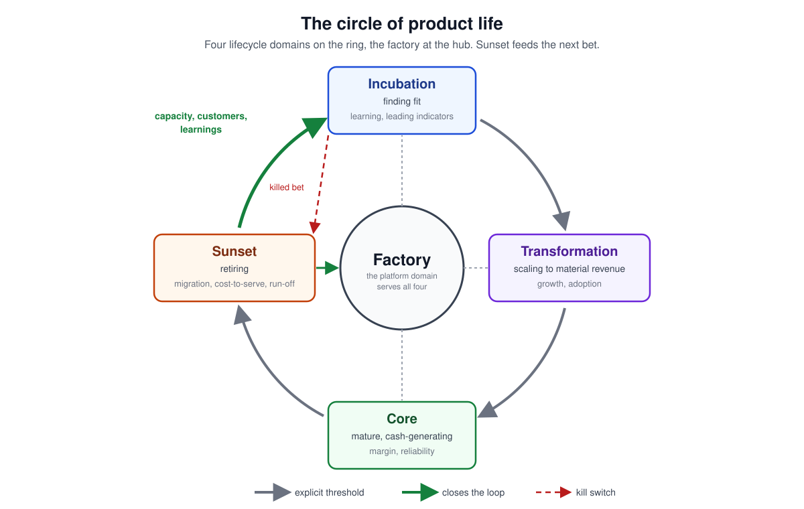
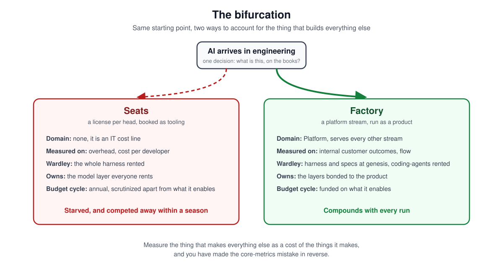

# Your Factory Is Not Tooling

Mik Kersten's *Project to Product* has sat within arm's reach since it came out. Projects assume that controlling the inputs controls the outcome. Software is complex work, so fund the product and steer by feedback. That is the book in two sentences, and I open it whenever someone needs reminding. His new one, [*Output to Outcome*](https://outputtooutcome.org/), is going on the same shelf. I read it in one go, I am re-reading it now with a marker and pen, and I expect to be using this one for years too.

It is a management book, and that is the point. Kersten's reading of six technological revolutions is that each one removed a production constraint and needed a new management method, and that the leaders who won each of them combined production expertise with management. He calls that shift Managers to Makers. The trap, every time, is to assume innovation is for the technologists while management stays as it was. One model in this book explains a bifurcation I foresaw forming among software companies adopting AI one year ago. I want to apply the Outcome Domain Model one level down, to the system that builds the software.

## Four domains, four rulers

The Outcome Domain Model is Kersten's answer to a familiar failure: innovation dies because it is measured like the mature business. His fix is structural: sort every value stream into one of four domains, each with its own metrics and its own work mix.

- **Incubation** is finding fit. Measure it on learning and leading indicators.
- **Transformation** is scaling toward material revenue. Measure it on growth and adoption.
- **Core** is mature and cash-generating. Measure it on margin and reliability.
- **Platform** serves the other three. Measure it on internal customer outcomes and flow, never on external revenue.

An early-stage startup is all Incubation. A mature non-growing company spends most of its time in Core, which is why Core's ruler so often ends up applied to everything.

I draw it as a ring, with one addition: Sunset, the stage a retiring stream passes through, so that what it releases flows back to Incubation. Measure it on migration completion, cost-to-serve and contract run-off. At the hub, serving all four, sits the platform domain. For a software company adopting AI, that hub is the factory.

The point is not the taxonomy. The point is that a stream judged with the wrong ruler produces the wrong decision. An incubation bet held to core metrics looks like a failure and gets killed. A platform held to revenue metrics looks like a cost and gets starved. The ruler is the decision.

## The stream nobody put on the map

Now look at what AI has done to how software gets made.

Two years ago the system that produced software at most companies was a set of habits: an editor, a build pipeline, a review process, decision records in a wiki. Nobody would have called it a product. Today, at the companies furthest past autocomplete, it is a system with parts: specifications that hold what the software must mean, transformers that turn those into structure, agents that fill in what is left, a harness of rules, tests and evals that decides what the agents may ship, and metrics on every run. The harness learns: from every mistake that slips through, and from every better frontier model and commodity agent that arrives, which it absorbs without the product noticing. It has users, who are your engineers, designers and product managers. It has a flow.

That is a value stream. In Kersten's terms it is a platform stream: it serves every other stream in the company and is measured on whether those streams get faster and better. Call it the factory. And it serves each domain differently. For Incubation, a prototype that costs an afternoon means the Outcome Loop closes many more times a quarter, and discovery is where outcomes are decided. For Transformation, it is scaling without the headcount curve. For Core, it is a lower cost to run, sometimes low enough to rebuild a stream rather than retire it.

Most companies have not put it on the map. They have put it in the ledger.

## Two ledgers

Imagine two companies of the same size, in the same cohort, renting the same models.

In the first, AI is a license per developer. It sits in the IT budget next to the enterprise-grade IDE and other dev tooling. It is measured on cost per head and, if anyone asks, on a productivity survey. It comes up once a year, when the renewal does, and the question asked of it is the price, never what it enabled.

In the second, the factory is a platform with a name and an owner. Its customers are the stream-aligned teams. It is measured on what it enables: the outcomes and flow of the streams it serves, how fast they move and what reaches their customers. The factory's own numbers, how much of a feature it writes before a person touches it, how many defects the harness catches before review, code health, what it cost to run, are leading indicators behind that, never the score. It is funded as capacity, similar to factories in the physical world.

Same vendors, same tokens. The difference is the financial model.

## Why the ledger starves it

The first company's finance function is not being careless. It is doing what finance did before AI, when cognitive work could only be bought one way: as salaried people. Payroll was capacity. Software was overhead. Every budget process, every approval threshold, every variance report is built on that divide.

Now cognitive work can be bought by the token. A token line behaves like capacity: spend more and more gets done. But it sits in the ledger that treats it like a stapler, so it is scrutinized like one: on the annual cycle, disconnected from what it enables. That is the starvation, and it has nothing to do with the technology. It is the pre-AI management model applied to an AI-era input.

Which brings us back to the trap. Of the two companies, the one pulling ahead did not pick a better frontier model. It changed how the factory is funded, measured and owned. That is how I read the whole book: the management model has to change first, or the technology changes nothing. Measure the thing that makes everything else as a cost of the things it makes, and you have made the core-metrics mistake in reverse.

## What a seat buys

The components of agentic engineering do not evolve at the same rate. Frontier models are moving from product to commodity: the benchmarks converge. Agents are moving from custom to product. The harness, the rules and checks that decide what an agent may ship, sits at genesis. Specifications, which hold what your software must mean, sit in custom.

When you buy a seat, you buy the commodity layer, the one every company in your cohort rents, and nothing else. I have [argued before](https://chronograph.rosenlidholm.se/ai-native-is-a-financial-shape) that a gain available to everyone for a monthly invoice is competed away within a season. [Models commoditize. The layers sandwiching them do not.](https://www.linkedin.com/feed/update/urn:li:activity:7491552249555542016/)

So the seat company's accounting is self-fulfilling. It bought the factory as a commodity, so it declared the factory a commodity, and for the layer it bought the declaration is correct. It is wrong for the layers it never built.

## Bonded to the product

Those layers cannot be bought, and not because nobody sells them. The harness encodes your definition of done. The specification language is domain-neutral but not architecture-neutral: it maps one-to-one onto your architecture, so a spec written in it has exactly one shape in your system. A [transformer](https://chronograph.rosenlidholm.se/two-stage-sdd-rocket) built for one product encodes that architecture's constraints and writes the structure of that product and no other. These things only work bonded to what they build. They are part of the product, which is why they sit at genesis or custom on the map.

And they multiply. An engineer or agent who improves the harness lifts every run, for every engineer and every agent, from then on. That is platform work. Kersten has a name for it, improvement objectives, funded explicitly and visible in the plan next to features rather than squeezed out by them. It deserves the platform ruler: internal customer outcomes and flow. Judge it on cost per head and it will always look expensive, because it is the one thing in the building that is not per head.

## Two honest objections

"We are not big enough to build a factory." Most companies are not big enough to build a general factory, and should not try. But a factory bonded to one product is small: a specification language, a transformer, a harness of rules, and the evals that avoid regressions and improve it. The seat is the entry ticket. The factory is what you do after you are in. I keep coming back to one of my favorite software engineering papers, Brian Foote and Joseph Yoder's [Big Ball of Mud](http://www.laputan.org/mud/): if you think good architecture is expensive, try bad architecture. The same logic applies to the factory. *If you think the factory is expensive, try seats.*

"The factory just makes typing faster." Kersten's value stream data puts building at a small fraction of end-to-end time. The rest is approvals, coordination and handoffs, and a factory that only speeds generation accelerates a non-bottleneck: more work in progress, more slop. The factory earns the platform ruler when it attacks the stream's actual constraint. That is why the harness matters more than the model. Deciding what may ship is where the factory meets review and approval, and that is where the time goes.

## Which domain is your factory in?

Companies that keep calling it tooling will measure it as overhead and starve it, which is the core-metrics mistake applied to the thing that makes everything else. Companies that put it on the map as a platform stream will fund it on what it enables, and it will compound.

Both rent the same models. Only one of them changed the management model first.
